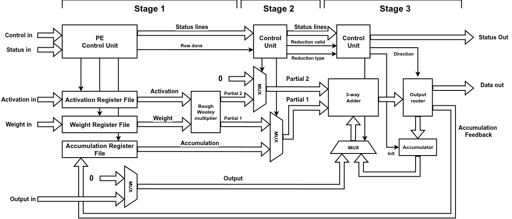

# Processing Element design 
The Processing Element is the base component used by the convolutional core. It is used to process a 1D convolution between a Weight (maximum 8x8b) and an Activation (15x8b). 
Its internal structure contains three *scratchpads*, for containing the inputs and the results computed for each shift, a multiplier and an adder, used for computing the actual convolutions. 

The PE is capable of processing a convolution, by leveraging on internal data reusage, with four different *stride modes* (1,2,4 or 8) and, at the same time, maintain the convolution outputs into an accumulation scratchpad using a feedback loop.  

The component has the following input/output lines: 
- **Control lines**, used for sending commands to the internal control unit, The available commands are *COMPUTE* and *UNLOAD*. This lines contains also a series of *VALID* bits, to signal an incoming activation or weight, and *init* bits, to initialize one or more internal queues.
- **Status in** and **Status out**, used for coordinating the current PE with another in the same accumulation line (column of the matrix) during an *UNLOAD* command execution. 
- **Activation in** and **Weight In**, used as inputs for the convolution operations.
- **Output In** and **Accumulation Out**, used during an *UNLOAD* phase, it represents the value of another PE's accumulator.
 
The PE can operate in three different modes: 
- **LOAD Phase**, where the PE receives all the necessary elements from the *activation in* and *weight in* needed for performing a complete 1-D convolution.
- **COMPUTE Phase**, where the PE process a certain number of convolutions using the *input scratchpads* and saves them into the *Accumulation scratchpad*.
- **UNLOAD Phase**, where the PE computes a certain number of sums between the data received from the *Output in* lines and one accumulation stored in the *accumulation scratchpad* 

## Internal structure: 

 

The Processing Element is composed by a three stage pipeline: 
1. The **first stage** contains the *PE control unit* and the *scratchpad registers*. Here, the PE controls the *scratchpads* as FIFO queues using more control and temporary registers, in order to leverage on data re-usage during the convolutions and avoid the necessity to receive data from the input lines. The *CU* uses the internal *Status lines* to control the next two pipeline stages.
2. The **second stage** contains a *Baugh-wooley carry save adder* that reduces the multiplication between an *activation* and a *weight* during a convolution. Two multiplexers are then used for managing the *partial results* and the accumulation received from the first stage depending on which mode the PE should operate. 
3. The **third stage** contains an *accumulator* and a *3-way Brent-Kung adder*. The *3-way adder* is used for computing a convolution element (*COMPUTE* phase) or compute the sum between a value contained in the *accumulation scratchpad* and the *output in* (*UNLOAD* phase). Using a *multiplexer* and an *output router*, the result of the sum is diverged in the right section of the *PE* (*Accumulator* during the convolution process, *Accumulation feedback* when a convolution element should be saved in the *scratchpad* or *accumulation out* during an *UNLOAD* process).

