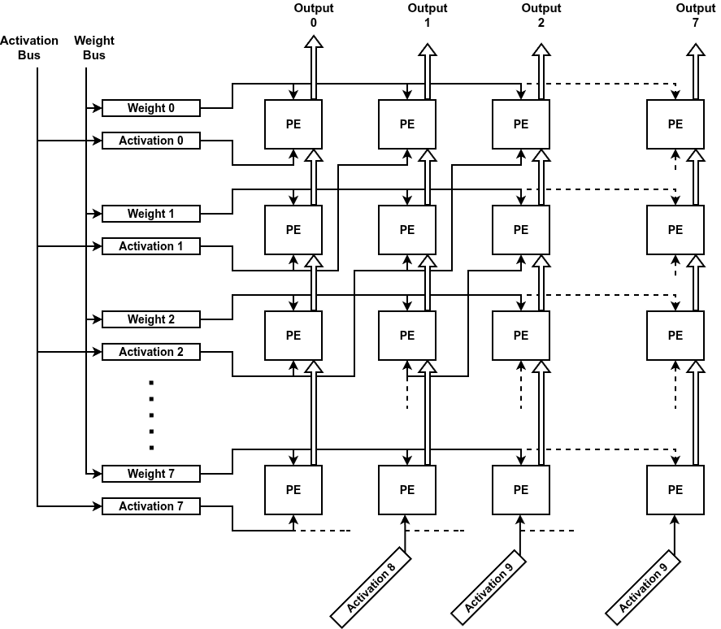
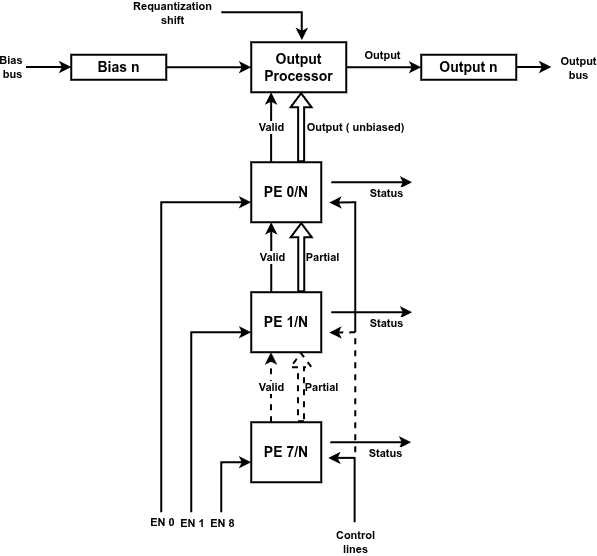

# Processing Element matrix design 
The *processor element matrix* is a 8x8 matrix composed by *PE* component connected together to enable parallel computation for 2-D convolutions. The design is largely inspired by the ["Eyeriss v1 CNN internal architecture"](https://eyeriss.mit.edu/) with some custom modifications thinked to enable *intermittent computing* on the final architecture.  

The main components of the *PE matrix* are: 
- **Data buffers**, which are FIFO queues with a *3-state* output used across the architecture to let the matrix communicate with the *I/O BUS*.
- **PE elements**, a single element in the *PE matrix*.
- **Output Processors**, a Processing Elements that performs *Biasing* and *Requantization*.
- A **Control Unit**, which decodes the commands received by the *matrix control bus* lines and enables/disables the *buffers* and *PEs* depending on the necessity.

## Matrix structure 

Both propagation of *Activations* and *Weights* follow a *broadcast strategy*, which allows to share all the elements across the entire PE matrix without introducing propagation delays:
- Each **weight row** is broadcasted horizontally for 8 *PE*.
- Each **activation row** is broadcasted diagonally for at max 8 *PE*.
  

 

The *Activation* and *Weight* buffers are connected in parallel to their dedicated *data bus*. 

The *Accumulation in* and *Accumulation out* lines, and the respective *valid* signals, of each PE are then connected in a vertical propagation chain. 

 

The *accumulation out* lines in the first row of the *PE matrix* is then connected to an *Output processor*, which applies *Biasing* and *Requantization* to reduce the *20-bit* results to *8-bit* and applies the *ReLu* function. 

This hybrid organization can banage both the computation of the convolution partials (temporary stored in the *PE scratchpads* during the *COMPUTE* phase) and their sum (during the *UNLOAD* phase) by leveraging on the *3-way adders* in the *PE* architecture. 

## Convolution scheduling 

As the *PE* in the 1-D convolution scenario, for executing a 2-D convolution using the *PE matrix* three phases are necessary: 
- **LOADING phase**, where the used *weight* and *activation* buffers are programmed to send a certain amount of data to the matrix. Here, the *control lines* are modified to signal the *PE* of the incoming data.
- **COMPUTING phase**, where the required *PE* in the matrix are enabled and the control lines of the *PE matrix* are used to send a *COMPUTE* command. During this phase, each enabled PE performs a certain number of convolution shifts between the *activation* and *weight* rows contained in the *scratchpads* and saves all the results in the *accumulation scratchpad*.
- **UNLOADING phase**, where the PE cooperates using their *accumulation I/O lines* chains to progressively sum all their partials into *20-bit* unbiased results, which are then processed by the *Output Processors* and stored in the *output buffers*.

The *LOADING* and *UNLOADING* phases of multiple convolution processes can be overlapped to increase the throughput and permit *out-of-order scheduling*.

## Buffers management

As the *Processing Elements*, the control unit sends commands to the buffers for loading/unloading a certain number of elements necessary for the execution of a command. 
A *Memory controller* is able to communicate with the buffers using the respective *Data bus* and *matrix buffer control bus/status bus*:
- A single **data bus** is shared among all the buffers of the same type (for example, all the *weight buffers* input lines are connected to the *weight bus*).
- The *memory controller* is able to select the buffers that should be activated for the communication through the bus (for example, it can enable the *activation buffer 0* when transmitting a certain *activaton row*).
- The *memory controller* is able to see the current status of the buffers (for example if they are ready or waiting for data).

## Scheduler 

A dedicated scheduler can send command to execute to the entire *PE matrix* and read the current status using the *matrix control/status bus*. Because, it should control also the memory controller, the scheduler is then able to execute more instructions at the same time. 

## To do list 

## To Do list
- [ ] Add an enable mechanism to mask certain PE during a *LOADING* phase.
- [ ] Optimize the internal architecture.
- [ ] Introduce checkpointing in the matrix buffers for intermittent computing.

